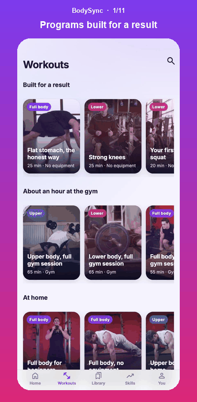

# BodySync

A free, phone-first workout app built with [Streamlit](https://streamlit.io). Pick a workout or build your own,
follow it set by set, and see your progress add up. Every tip in the app is backed by a cited study.



### What makes it different

- **Backed by research.** Every recommendation links to the study it comes from.
- **Explains the why.** Each move says what it works and how it fits your goal.
- **Honest goals.** For example, the flat-stomach plan says ab moves alone don't burn belly fat, and pairs strength with walking.
- **Gets harder with you.** It suggests your next weight and reps from what you did last time.
- **Yours to build.** Make playlists from 870+ exercises, or add your own with two photos.
- **Your data stays yours.** With Google sign-in, everything is saved to your own Google account, not to a database we run.

**Built with:** Python, Streamlit, Google sign-in and Google Drive, Gemini (optional), SQLite for local use.

<br clear="right">

## Features

- **Workouts:** curated workouts for home and the gym, each showing what it targets and why.
- **Guided sets:** moving demos, a rest timer, pause, and changes mid-workout.
- **Progressive overload:** suggests your next weight and reps from last time.
- **Playlists:** build your own workouts, including your own exercises with photos.
- **Skills:** step-by-step ladders (push-up, pull-up, pistol squat, handstand, splits).
- **Plan my week:** pick your days and goals, plus an optional walking habit.
- **Progress:** weekly streak, totals, and history.
- **Nutrition:** a daily protein target and tally (no calorie counting).
- **FitBuddy AI (optional):** weekly plans and meal ideas with Gemini.

## Run it locally

You need Python 3.10 or newer.

```bash
git clone https://github.com/JaffaraH/bodysync-streamlit-workout-app.git
cd bodysync-streamlit-workout-app
python3 -m venv .venv
source .venv/bin/activate          # Windows: .venv\Scripts\activate
pip install -r requirements.txt
python run.py
```

The app opens at <http://localhost:8501>. There's no sign-in on your own computer, and your data stays in the
`data/` folder. On first run, `run.py` downloads the open exercise database and asks for optional API keys (press
Enter to skip).

| Optional key | Turns on | Get it |
|---|---|---|
| `GEMINI_API_KEY` | FitBuddy AI and meal ideas | [Google AI Studio](https://aistudio.google.com/apikey) (free) |
| `GIPHY_API_KEY` | GIFs between sets | [GIPHY Developers](https://developers.giphy.com/) (free) |
| `EDAMAM_APP_ID`, `EDAMAM_APP_KEY` | Recipe search | [Edamam](https://developer.edamam.com/) |

## Run the tests

```bash
for t in training skills drive db_contract research plan protein custom ai targets; do python tests/test_$t.py; done
```

## Details

- [docs/ARCHITECTURE.md](docs/ARCHITECTURE.md): how the code is organised, and how to add workouts, exercises and skills.
- [DEPLOY.md](DEPLOY.md): host your own copy with Google sign-in.
- [PRIVACY.md](PRIVACY.md): what is stored and where.
- [docs/TODO.md](docs/TODO.md): what is built but not tested yet.
- [docs/RESEARCH_AUDIT.md](docs/RESEARCH_AUDIT.md) and [research.json](research.json): the research behind each recommendation.

## Credits

- Exercises and photos: [Free Exercise DB](https://github.com/yuhonas/free-exercise-db) (public domain).
- Pike Push-Up drawing: [wger.de](https://wger.de/en/exercise/454/view/) contributors, CC BY-SA 4.0.
- Celebration flame: [Noto Emoji](https://github.com/googlefonts/noto-emoji) by Google, CC BY 4.0.

## Contributors

- [JaffaraH](https://github.com/JaffaraH)
- [alishuhh](https://github.com/alishuhh)
- [ba-00001](https://github.com/ba-00001)
