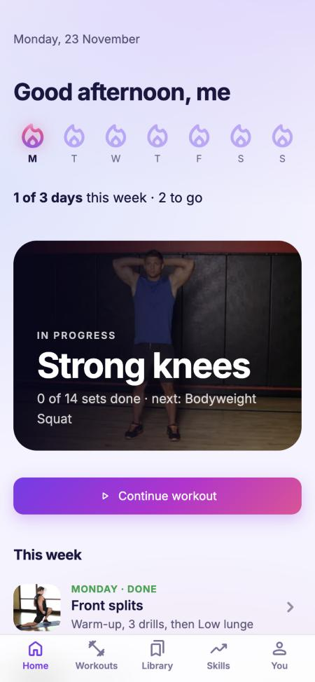
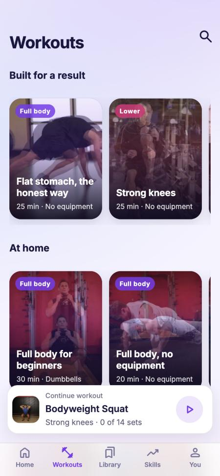
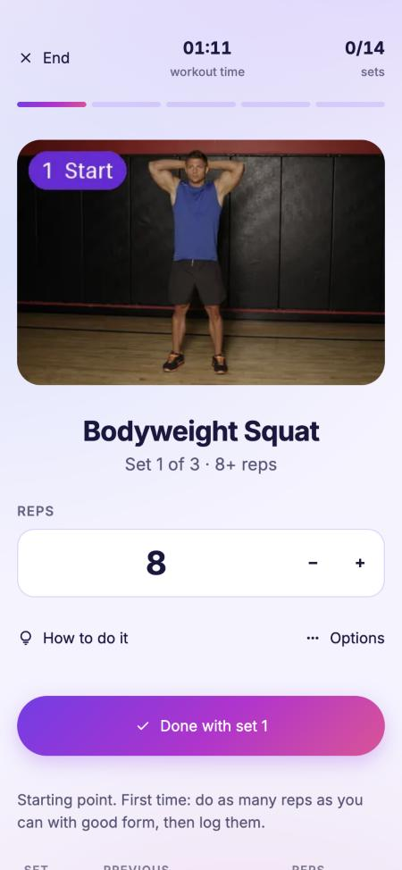
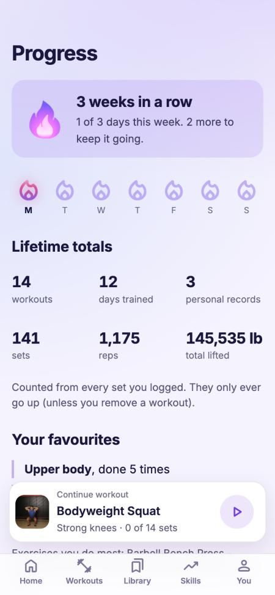
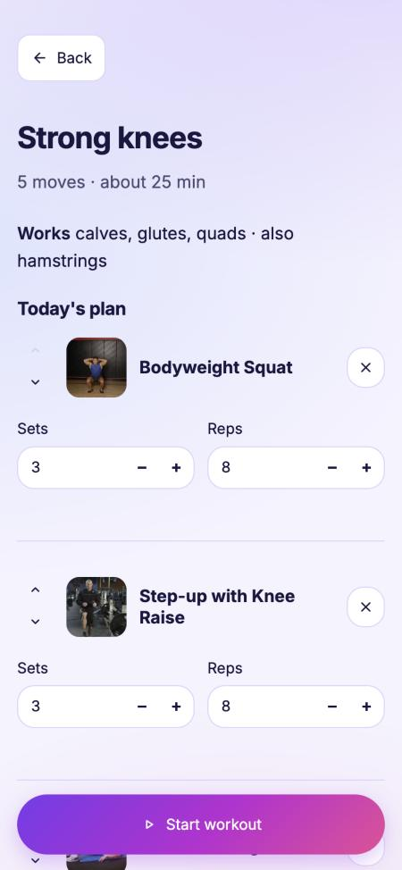
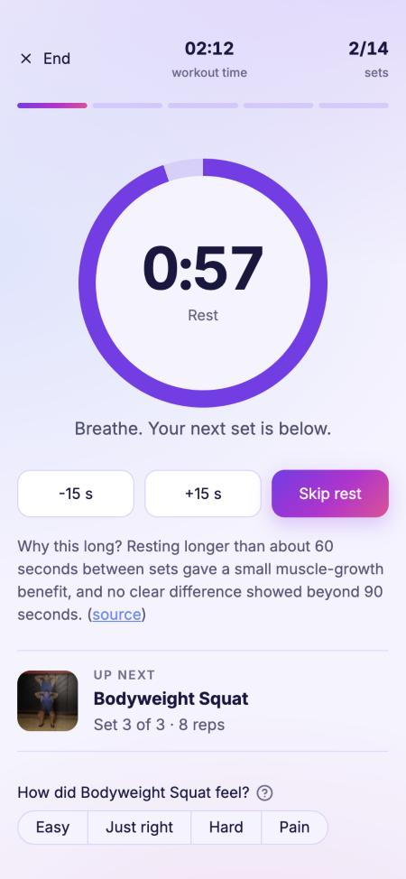
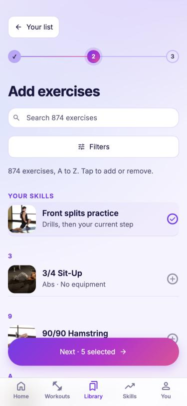
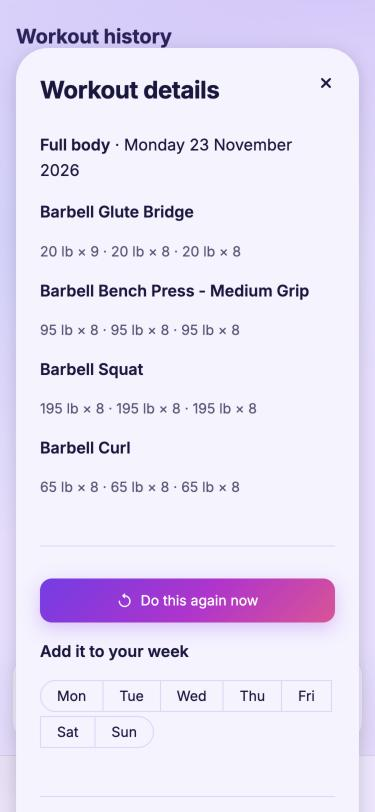

# BodySync

A free, phone-first workout app built with [Streamlit](https://streamlit.io). Pick a workout or build your own,
follow it set by set with moving demos, and watch your progress add up. Every recommendation in the app links to
the study it comes from.

<p>




</p>

This README has three parts. Read the one that fits you:

1. [**Use it**](#1-use-it): what the app does, and how to run it.
2. [**Learn from it**](#2-learn-from-it): how a Streamlit app this size is put together. The full walkthrough is in [docs/ARCHITECTURE.md](docs/ARCHITECTURE.md).
3. [**Fork it**](#3-fork-it-safely): make your own version without ever touching anyone else's data.

---

## 1. Use it

**Who it's for:** people who want to train regularly, follow workouts that are built on evidence, make their own,
and see real progress, without paying for an app or handing their data to one.

| | What you get |
|---|---|
| **Workouts** | Curated workouts in rows (at home, at the gym, about an hour at the gym, push/pull/legs, stretch). The first row, *Built for a result*, has programs with a goal, how often to train, and honest expectations: a flat-stomach plan that pairs strength with daily walking (ab moves alone don't burn belly fat), strong knees, a first pistol squat, a first handstand, and a Pilates-inspired core session. |
| **Before you start** | A ready page shows the moves, the time, and the muscles worked, then offers a 5-minute warm-up. You can still change sets, reps, seconds and weight, reorder moves, remove them or add more. The clock starts only when you tap *Start workout*. |
| **During a workout** | One set at a time, with pause. The demo moves between two labelled positions (*1 Start*, *2 Finish*). Then a rest ring that drains smoothly and chimes at the end. Everything can be changed mid-workout without starting over. |
| **Progressive overload** | Each lift suggests your next weight and reps from what you did last time (top of the rep range on every set: add weight; otherwise add a rep). Your first time is your baseline; each new best becomes the number to beat. |
| **Playlists** | Your own workouts in three steps: name it and pick what to work on (or skip), choose exercises (search, filters, A to Z, or create your own with two photos), then set sets and reps, reorder and swap. |
| **Skills** | Step-by-step ladders (push-up, pull-up, pistol squat, handstand, splits, toe touch). You move up after hitting a step's target twice in a row. |
| **Plan my week** | Pick your days and one or more goals; the week fills in. Open any day to see and edit its workout, add a skill practice to a workout day, and set a walking habit (for example 10,000 steps on 4 days) that sits on top of any day. Home shows today's plan and the walk to tick off. |
| **Progress** | Weeks in a row (counted against your own weekly goal), lifetime totals from real logged sets, your favourite workouts, the body area that needs you most, and your history. Any past workout can be repeated, put on your week, or removed. |
| **Nutrition** | Protein only, on purpose (no calorie counting): a daily target from your body weight, a tally of the foods you have, top-ups from those foods, and your own meals saved for one-tap logging. With AI, a meal idea from your ingredients that you can log or save. All numbers are estimates. |
| **FitBuddy AI** (optional) | A weekly plan built only from library exercises, saved as real playlists in one tap; a gym machine photo turned into one of your own exercises; meal ideas from your kitchen. The app owner adds one Gemini key and everyone gets a daily allowance; nobody has to paste a key. |

<p>




</p>

### Run it on your computer (about 2 minutes)

You need Python 3.10 or newer.

```bash
git clone https://github.com/JaffaraH/bodysync-streamlit-workout-app.git
cd bodysync-streamlit-workout-app
python3 -m venv .venv
source .venv/bin/activate          # Windows: .venv\Scripts\activate
pip install -r requirements.txt
python run.py
```

`run.py` downloads the open exercise database on first run and opens the app at <http://localhost:8501>. There
is no sign-in on your own computer, and your data stays in the git-ignored `data/` folder. API keys are optional;
press Enter to skip them.

| Optional key | Turns on | Where to get it |
|---|---|---|
| `GEMINI_API_KEY` | FitBuddy AI and meal ideas for everyone using your copy (20 requests per person per day, set with `AI_DAILY_LIMIT`) | Free at <https://aistudio.google.com/apikey> |
| `GIPHY_API_KEY` | Fun G-rated GIFs between sets and at the finish | Free at <https://developers.giphy.com/> |
| `EDAMAM_APP_ID` / `EDAMAM_APP_KEY` | Recipe search (hidden without keys) | <https://developer.edamam.com/> |

Want family or friends to use your copy? See [DEPLOY.md](DEPLOY.md): Google sign-in, each person's data in their
own Google Drive, free hosting on Streamlit Community Cloud.

---

## 2. Learn from it

BodySync is about 9,700 lines of Python, with no JavaScript framework and no backend server of its own. It's a
good codebase for learning how far plain Streamlit can go. Start with [docs/ARCHITECTURE.md](docs/ARCHITECTURE.md),
which follows one workout from the tap on a tile to the saved set, function by function.

**The Streamlit features it uses, and why** (all free, all part of Streamlit itself):

| Feature | Used for | Where |
|---|---|---|
| `st.navigation` + `st.Page` (hidden) | Multipage app with its own phone tab bar | `homepage.py` |
| `st.session_state` | Every flow's state (which step, what's picked), plus a per-session data cache | everywhere, `session_data.py` |
| `st.login` / `st.user` / `st.logout` | "Sign in with Google" without writing OAuth code | `auth.py` |
| `st.context.headers`, `st.context.theme` | Refusing shared accounts on public addresses; light and dark colours | `auth.py`, `ui.py` |
| `st.dialog` | Workout details, add exercises, options during a set | `today.py`, `progress.py` |
| `st.fragment(run_every=1)` | Clocks that tick without rerunning the whole page | `today.py` |
| `st.container(key=...)` | Stable CSS hooks (`.st-key-...`) for tap rows, tiles and pinned buttons | `ui.py` |
| `st.html` (JavaScript only for the chime and scroll-to-top) | Custom cards, and animated demos as `` | `ui.py` |
| `st.pills`, `st.segmented_control`, `st.toggle`, `st.number_input` | Phone-friendly inputs | everywhere |
| `st.cache_data` | The 870-exercise database, loaded once | `exercise_data.py` |
| `st.altair_chart` | Progress charts with tooltips | `progress.py` |
| `st.switch_page`, `st.page_link` | Moving between tabs on purpose | `ui.py`, `lifts.py` |
| `st.write_stream`, `st.chat_message` | Streaming AI answers | `ui.py`, `chat.py` |
| `st.download_button` | Export all your workouts as CSV | `progress.py` |
| `.streamlit/config.toml` | Light and dark themes, the Inter font, and static file serving for demos | `.streamlit/` |

**Lessons learned the hard way** (each one is explained in a comment where it's handled):

- `st.image` re-encodes animated WebP and keeps only the first frame. Moving demos are drawn as `` with `st.html` (`ui.demo`).
- An invisible button laid over a card only works if its wrapper is forced to full size with `!important`, because Streamlit sets a fixed width on it inline (`ui.TAP_CSS`).
- `st.html` sanitises its HTML, so CSS containing angle brackets (`syntax: '<number>'`) gets dropped. Write `\3c number\3e` instead (`today._rest_panel`).
- A widget's value is forgotten when it isn't drawn. Multi-step flows keep their own copy in `st.session_state` (`playlist_builder._s`).
- Streamlit keeps the scroll position between reruns, so a new step of a flow asks to start at the top (`ui.to_top`).

Run the tests (plain Python, no test framework needed):

```bash
for t in training skills drive db_contract research plan protein custom ai targets; do python tests/test_$t.py; done
pip install pyflakes && python -m pyflakes *.py   # catches names used but never defined
```

---

## 3. Fork it safely

Forking this repository gives you **code only**. No user data is in the repository, and no fork can reach anyone
else's data:

- **On your computer**, data lives in `data/` (git-ignored).
- **When hosted with Google sign-in**, each person's data is a private file in **their own** Google Drive app folder. Only the copy of the app they signed in to can open it. The original authors can't see it, and neither can you.
- **A public copy without sign-in won't open.** It shows a setup page instead, because everyone would otherwise share one account (`auth.on_private_network`).
- **Secrets never go in the repo.** `.env` and `.streamlit/secrets.toml` are git-ignored; only the `.example` templates with placeholders are committed. A Gemini key someone pastes into the app lives in their browser session only.
- **SQL** always passes values as parameters, never pasted into the query text.
- **Names people type** (playlists, custom skills) are escaped before they're shown, and `st.html` strips scripts as a second layer.

How to add the common things:

| I want to... | Do this |
|---|---|
| Add a curated workout | Add an entry to `curated_workouts.json` (exercise names must exist in the exercise database) and cite its research ids |
| Add a research-backed tip | Add an entry to `research.json` with a real source; mark it `"verified"` only after you've read the source |
| Add an exercise the database lacks | Two photos (start, finish) in `static/<source>/<name>/`, and an entry in `extra_exercises.json` with its license and author |
| Add a skill ladder | A new ladder in `progressions.json` (steps, targets, demos) |
| Change colours | `.streamlit/config.toml` and the colour tokens in `ui.py` |

---

## Data and credits

- Exercises and photos: the public-domain [Free Exercise DB](https://github.com/yuhonas/free-exercise-db). Every exercise there has exactly two photos (a start and an end), so moves like circles show a note and their written steps.
- Pike Push-Up drawing: wger.de contributors ([wger.de](https://wger.de/en/exercise/454/view/)), CC-BY-SA 4.0, split into two positions.
- Celebration flame: [Noto Emoji](https://github.com/googlefonts/noto-emoji) by Google, CC BY 4.0, recoloured.
- The research behind each recommendation is in [research.json](research.json), and the reasoning is in [docs/RESEARCH_AUDIT.md](docs/RESEARCH_AUDIT.md).

## Contributors

BodySync started as a team project. Thank you to everyone who built the original:

- [JaffaraH](https://github.com/JaffaraH)
- [alishuhh](https://github.com/alishuhh)
- [ba-00001](https://github.com/ba-00001)
